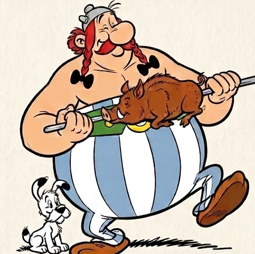

# Dégommix — Spécifications (v2)

> Le classement officieux de vos parties de petits chevaux Astérix — qui dégomme qui, qui tient le village.

- **Maquette interactive (artefact)** : [`docs/maquette.html`](docs/maquette.html) — ouvrir dans un navigateur ; version en ligne sur [claude.ai/code/artifact](https://claude.ai/code/artifact/f4df3e73-6faf-4694-9890-cd2a6128256a)
- **Document de design technique** : [`docs/superpowers/specs/2026-07-25-degommix-design.md`](docs/superpowers/specs/2026-07-25-degommix-design.md)
- **Déploiement cible** : `degommix.tristanhourtoulle.fr` (Railway, CNAME)

---

## 1. Brief du projet

Dégommix est une **PWA mobile** pour suivre les parties du *Jeu des Petits Chevaux — Astérix le Gaulois* (édition limitée Éditions Atlas, 2006). Le plateau physique reste le jeu ; l'app est le compagnon de table qui enregistre ce qui s'y passe :

- Chaque joueur a **son compte** (et son téléphone — un téléphone par joueur en v1).
- On démarre une **partie synchronisée** entre les téléphones des joueurs présents.
- Pendant la partie, chacun **loggue manuellement ses propres dégommages** (pion adverse renvoyé à l'écurie) en un tap.
- L'app trace la **durée des parties**, les dégommages, le vainqueur.
- Un **classement scopé au cercle d'amis** (soi + ses amis, jamais global à l'app) cumule victoires, dégommages, winrate par joueur et par personnage.

L'app est un outil de petit comité privé : **français uniquement**, mobile uniquement, sans onboarding de règles ni dispositif RGPD.

### Nom

**Dégommix** — jeu de mot sur « dégommer » (l'action centrale du jeu) + le suffixe gaulois « -ix » de la licence. Choisi parmi d'autres pistes (Pionix, Obéludix, Alea Ludix…).

## 2. Les personnages

Le jeu physique propose exactement **4 personnages**, chacun avec sa couleur de camp. Toute l'identité visuelle de l'app en découle. Les visuels sont découpés depuis l'image source fournie (`Image JPEG.jpeg`) :

| Personnage | Camp | Couleur | Image |
|---|---|---|---|
| Astérix | Gaulois | Rouge `#b23a2e` |  |
| Obélix | Gaulois | Bleu `#2c5b82` |  |
| Caïus Bonus | Romains | Jaune `#b9861f` |  |
| Caligula Minus | Romains | Vert `#3f6b3c` |  |

Fichiers : [`assets/characters/`](assets/characters/) — `asterix.png`, `obelix.png`, `caius-bonus.png`, `caligula-minus.png`.

**Préparation des assets (début d'implémentation)** : les 4 PNG actuels ont un fond parchemin **non transparent** et des cadrages hétérogènes (Astérix en buste, les autres en pied). Prévoir :
- un **détourage** (fond quasi uniforme, automatisable) ;
- des **recadrages « tête » dédiés** pour les badges circulaires.

La résolution actuelle (435 px) suffit pour les badges et reste acceptable en fond basse opacité.

## 3. Mode de jeu

- **FFA uniquement (chacun pour soi)** — seul mode pour la v1.
- **2 à 4 joueurs** par partie.
- Le **personnage se choisit librement à chaque partie** (non lié au compte), mais il est **unique par partie** : 4 personnages, 4 joueurs max, pas de doublon. En cas de sélection simultanée, **premier arrivé au serveur** gagne le personnage ; l'autre joueur est notifié. Changement possible **avant le lancement uniquement**, jamais après. Toutes les combinaisons restent possibles, y compris un 1v1 Romain contre Romain.
- Un joueur a un « personnage fétiche » statistique (le plus joué ; en cas d'égalité, le plus récemment joué), affiché sur son profil et au classement.
- Règle maison de la table : entrée des pions sur **6/5/4/3** — sans incidence sur l'app, qui ne suit pas les pions (voir §4).

### Fin de partie (demande + validation par l'host)

- **N'importe quel joueur peut demander** une fin de partie, de trois types :
  1. **Village atteint** — la demande désigne le joueur vainqueur ;
  2. **Abandon individuel** — le demandeur quitte la partie, qui continue si possible ;
  3. **Abandon total** — la partie s'arrête pour tout le monde, sans vainqueur.
- **Seul l'host valide** la demande (ou la rejette). Si l'host demande lui-même, la validation est **directe**, avec une simple modale de confirmation.
- Le vainqueur = le joueur désigné dans la demande « village atteint » **validée**. La validation fige durée, dégommages et vainqueur.

### Undo

- **Illimité** : le journal est une pile, on peut remonter toutes les actions annulables.
- Déclenchable par **n'importe quel joueur** de la table.
- **Tracé visiblement** dans le journal (« X a annulé … ») — jamais de suppression silencieuse.
- Possible **jusqu'à la clôture validée par l'host** ; après, plus aucune correction (pas d'édition rétroactive).
- L'undo est le garde-fou : aucune confirmation n'est demandée au moment de logguer un dégommage.

## 4. Fonctionnalités

### Comptes

- **Email + mot de passe** (Better Auth). Pseudo choisi à l'onboarding : **20 caractères max, unique insensible à la casse**.
- Avatar = **initiale du pseudo dans un anneau bronze** (comme la maquette).
- V1 **sans** : récupération de mot de passe, suppression de compte, photo de profil.
- Un compte = un joueur = un téléphone. **Une seule partie ou lobby actif par compte** à la fois.

### Amis

- **Recherche partielle par pseudo** (input + debounce), globale à l'app.
- Demandes d'ami : accepter / refuser ; une demande est **annulable et renvoyable**.
- **Suppression d'ami silencieuse** (l'autre n'est pas notifié). Pas de blocage en v1. Pas de limite d'amis.
- **Présence par heartbeat websocket** : statut en ligne / en partie / hors ligne, « hors ligne » après ~60 s sans signal.
- **Profil et stats visibles par les amis uniquement.**
- Un ami peut être **invité en un tap** dans une partie, sans code.

### Créer / rejoindre une partie

- Deux entrées : **Créer** ou **Rejoindre**.
- Créer : choix du format (2/3/4 joueurs), invitation d'amis, choix des personnages ; lancement bloqué tant que toutes les invitations en attente ne sont pas résolues.
- Rejoindre : **code de partie à 6 caractères** — valable jusqu'au lancement (ou à la dissolution du lobby), **jamais réutilisé**. Un **inconnu peut rejoindre avec le code** : il compte dans les stats de la partie, mais n'apparaît pas dans le classement de ton cercle d'amis.
- Invitations **in-app uniquement** (websocket) : bannière sur l'accueil + onglet Rejoindre. Pas de Web Push en v1. L'invité peut **décliner** (l'host est notifié).
- Pouvoirs de l'host dans le lobby : **annuler une invitation en attente** (débloque le lancement), **expulser** un joueur, **changer le format** 2/3/4 si compatible avec les joueurs présents.
- Pas de spectateur ; **impossible de rejoindre une partie déjà lancée**.
- **« Rejouer »** = un nouveau lobby avec les mêmes joueurs ré-invités ; l'host est celui qui tape le bouton.
- **Transfert d'host** : si l'host devient injoignable (lobby ou partie), le rôle passe automatiquement au **joueur connecté le plus ancien** de la partie.

### Suivi de partie en live (écran central)

- **Synchronisation temps réel** entre tous les téléphones de la partie : même état partout (compteurs, chrono, journal).
- **Chrono serveur**, démarré au lancement par l'host, visible en permanence. Pas de pause.
- Carte par joueur : **portrait du personnage + compteur de dégommages** — c'est tout. Pas de suivi des pions (trop lourd à logger) : aucun pion visuel sur l'écran live.
- Action principale : **« Tu viens de dégommer qui ? »** — chacun loggue **ses propres** dégommages, **un tap par pion dégommé** (2 pions = 2 taps), sur le portrait de l'adversaire concerné. Pas de confirmation (l'undo est le garde-fou), pas d'auto-dégommage (on ne se dégomme pas soi-même). Pas de saisie manuelle de score.
- **Annuler** (undo illimité, partagé, tracé — voir §3) — bouton pleine largeur.
- **Demander la fin de partie** (village atteint / abandon) — bouton pleine largeur ; validation par l'host (voir §3).
- **Journal live = les 2 dernières actions, non dépliable pendant la partie.** Le journal complet est stocké en base et consultable dans le détail d'une partie terminée. Il ne contient que : dégommages, undos, événements de partie (join/quit/fin).
- **Écran plein** : la tab bar est masquée pendant une partie en cours. **Wake Lock** actif (l'écran ne se met pas en veille).
- **Joueur qui quitte définitivement** : la partie continue si possible ; ses pions sont rangés hors du plateau (il sort du jeu) ; ses dégommages restent au journal.
- **Partie zombie** : auto-clôturée en abandon après **24 h d'inactivité**.

### Résumé de partie

- Header : **le joueur vainqueur** avec son personnage en grand, image en fond basse opacité. S'adapte au format réel de la partie (1v1, 3 ou 4 joueurs) — le gagnant est un joueur, jamais un camp.
- Récap par joueur en **icônes plutôt qu'en texte** : épée = dégommages. (Pas d'icône pion : les pions ne sont pas suivis.)
- Tuiles : durée, total de dégommages, format (1v1 / 3J / 4J).
- Actions : « Voir le classement », « Rejouer ».

### Classement & stats

- Classement des joueurs **scopé au cercle d'amis (+ soi)**, jamais global à l'app : victoires, winrate, personnage fétiche.
- **Départage** : victoires > winrate > dégommages.
- Mise en avant du **plus grand dégommeur**.
- **Winrate par personnage** (barres colorées avec portrait), calculé sur les parties du cercle — pour savoir si Astérix est vraiment plus fort qu'Obélix chez vous.
- **Parties abandonnées** : les dégommages comptent, mais la partie est **exclue du dénominateur du winrate**.
- Winrate **brut, toutes tailles de partie confondues** (le format est affiché à titre indicatif).
- Historique sur l'accueil : **mes 20 dernières parties** ; chaque partie a une **page détail avec le journal complet**.
- **Pas d'édition rétroactive** : la fenêtre d'undo avant clôture est la seule correction possible.

## 5. Direction artistique & navigation

| Élément | Choix |
|---|---|
| Ambiance | **BD / parchemin illustré** — textures papier ancien, proche de la boîte du jeu |
| Palette | Parchemin `#ece0c4`, encre `#251a10`, bronze `#8c5a2b` + les 4 couleurs des personnages |
| Typo display | **Cinzel** (capitales romaines, style colonne Trajane) — titres, boutons, wordmark |
| Typo courante | Système (SF/Segoe/Roboto) pour la lisibilité mobile |
| Icônes | **Nucleo** — export SVG depuis la webapp Nucleo (compte connecté dans Chrome), conventions grille 24px / trait 1.8 ; à faire au moment du design system. La maquette utilise un set de substitution aux mêmes conventions |
| Personnages | **Visuels officiels détourés** (voir §2), jamais de simple pastille de couleur ; recadrages « tête » pour les badges circulaires, images en fonds basse opacité |
| Avatars joueurs | Initiale du pseudo dans un anneau bronze (pas de photo de profil en v1) |
| Thèmes | Clair et sombre (tokens CSS, `prefers-color-scheme` + toggle `data-theme`) |
| Navigation | **Bottom tab bar style iOS 26 / Instagram « liquid glass »** (effet bulle d'eau, slide animé entre onglets) — onglets : **Accueil, Amis, Jouer, Classement**. Masquée pendant une partie en cours (écran live plein écran) |
| Anti-patterns exclus | Cards à border-left colorée, journal envahissant, header générique |

## 6. Choix techniques (validés au kickoff)

### Stack

- **Monorepo pnpm workspaces + Turborepo** :
  - `apps/web` — Next.js 15, TypeScript, Tailwind CSS (UI + auth + lectures) ;
  - `apps/ws-server` — Node + Socket.IO (temps réel autoritaire) ;
  - `packages/game-core` — types d'événements + réducteur d'état partagé client/serveur, TypeScript pur.
- **Hébergement** : Railway all-in-one (web + ws-server + Postgres), domaine `degommix.tristanhourtoulle.fr` (CNAME).
- **Auth** : Better Auth (email + mot de passe) ; **JWT vérifié au handshake WebSocket**.

### Modèle d'état : event sourcing append-only

- Table `game_events` : `id`, `game_id`, `seq` (attribué par le serveur), `type`, `actor_id`, `target_id`, `client_event_id` (UUID unique pour l'idempotence), `created_at`.
- **L'undo est un événement `UNDO` appendé** (jamais de `DELETE`) ; le réducteur ignore l'événement ciblé. Le journal est la source de vérité de l'état de partie.
- **Reconnexion** : le client envoie son dernier `seq` connu, le serveur renvoie la suite (ou tout le journal). L'ordre des événements = **ordre d'arrivée au serveur**.
- **Serveur WS autoritaire** : valide chaque événement (partie active, joueur membre, undo cohérent, transitions de fin de partie), attribue `seq`, persiste, broadcast à la room.

### PWA & résilience

- **PWA installable** : manifest + service worker (**Serwist**) qui ne cache **que le shell statique**, jamais les réponses API/WS.
- **Pas de mode offline** (pas de consultation hors ligne). En cas de micro-coupure pendant une partie : **retry automatique court du tap** + **resync complète à la reconnexion** (idempotence via `client_event_id`).
- Une partie en cours survit à un refresh / une perte de réseau courte (reprise depuis l'accueil).
- Mobile uniquement : pas d'optimisation desktop/tablette.

### Tests

- Réducteur `game-core` **testé unitairement à fond** : ordre, undo, doublons, fins de partie.
- **Intégration ws-server** avec 2-4 clients `socket.io-client` simulés (Vitest).
- **Un parcours E2E Playwright multi-contextes** sur le happy path.

## 7. Hors périmètre v1

- Modes en équipe (Gaulois vs Romains 2v2) — le FFA couvre tous les usages actuels.
- Détection automatique des mouvements de pions (tout est déclaratif, au tap) et **suivi des pions restants** (supprimé au kickoff : trop lourd à logger).
- Plus de 4 joueurs, tournois, saisons.
- **Mode « partie locale »** multi-joueurs sur un seul téléphone (celui de l'host) — reporté en V2.
- Récupération de mot de passe, suppression de compte, photo de profil.
- Blocage d'amis.
- Web Push (invitations in-app via websocket uniquement).
- Mode offline, optimisation desktop/tablette, langues autres que le français.
- Onboarding des règles du jeu, dispositif RGPD (petit comité privé).
- Spectateurs, rejoindre une partie lancée, édition rétroactive des parties.

---

*Document v2 — intègre les arbitrages du 25 juillet 2026. Base initiale : itérations de design de juillet 2026 (maquette v4).*
