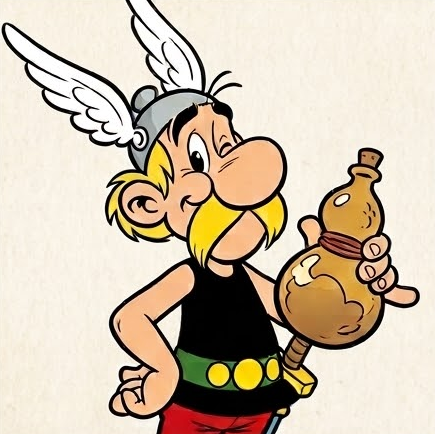
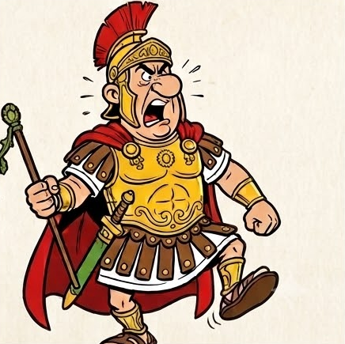
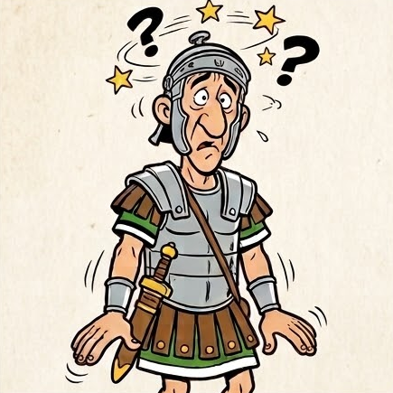

# Dégommix — Spécifications

> Le classement officieux de vos parties de petits chevaux Astérix — qui dégomme qui, qui tient le village.

- **Maquette interactive (artefact)** : [`docs/maquette.html`](docs/maquette.html) — ouvrir dans un navigateur ; version en ligne sur [claude.ai/code/artifact](https://claude.ai/code/artifact/f4df3e73-6faf-4694-9890-cd2a6128256a)
- **Déploiement cible** : `degommix.tristanhourtoulle.fr`

---

## 1. Brief du projet

Dégommix est une **PWA mobile** pour suivre les parties du *Jeu des Petits Chevaux — Astérix le Gaulois* (édition limitée Éditions Atlas, 2006). Le plateau physique reste le jeu ; l'app est le compagnon de table qui enregistre ce qui s'y passe :

- Chaque joueur a **son compte**.
- On démarre une **partie synchronisée** entre les téléphones des joueurs présents.
- Pendant la partie, chacun **loggue manuellement ses dégommages** (pion adverse renvoyé à l'écurie) en un tap.
- L'app trace la **durée des parties**, les pions restants, le vainqueur.
- Un **classement** cumule victoires, dégommages, winrate par joueur et par personnage.

### Nom

**Dégommix** — jeu de mot sur « dégommer » (l'action centrale du jeu) + le suffixe gaulois « -ix » de la licence. Choisi parmi d'autres pistes (Pionix, Obéludix, Alea Ludix…).

## 2. Les personnages

Le jeu physique propose exactement **4 personnages**, chacun avec sa couleur de camp. Toute l'identité visuelle de l'app en découle. Les visuels sont découpés depuis l'image source fournie (`Image JPEG.jpeg`) :

| Personnage | Camp | Couleur | Image |
|---|---|---|---|
| Astérix | Gaulois | Rouge `#b23a2e` |  |
| Obélix | Gaulois | Bleu `#2c5b82` |  |
| Caïus Bonus | Romains | Jaune `#b9861f` |  |
| Caligula Minus | Romains | Vert `#3f6b3c` |  |

Fichiers : [`assets/characters/`](assets/characters/) — `asterix.png`, `obelix.png`, `caius-bonus.png`, `caligula-minus.png`.

## 3. Mode de jeu

- **FFA uniquement (chacun pour soi)** — seul mode pour la v1.
- **2 à 4 joueurs** par partie.
- Le **personnage se choisit librement à chaque partie** (non lié au compte) : toutes les combinaisons sont possibles, y compris un 1v1 Romain contre Romain (Caïus Bonus vs Caligula Minus).
- Un joueur a un « personnage fétiche » statistique (le plus joué), affiché sur son profil et au classement.
- Fin de partie : **« Village atteint »** — le premier joueur qui rentre ses pions au village gagne ; l'action clôt la partie pour tout le monde et fige durée, dégommages et vainqueur.

## 4. Fonctionnalités

### Comptes & amis
- Compte par joueur (pseudo, avatar, stats cumulées).
- **Liste d'amis** : recherche par pseudo, demandes d'ami (accepter/refuser), statut (en ligne / en partie / hors ligne).
- Un ami peut être **invité en un tap** dans une partie, sans code.

### Créer / rejoindre une partie
- Deux entrées : **Créer** ou **Rejoindre**.
- Créer : choix du nombre de joueurs (2/3/4), invitation d'amis, choix des personnages ; lancement bloqué tant que tous les invités n'ont pas rejoint.
- Rejoindre : **code de partie à 6 caractères**, ou acceptation d'une **invitation reçue en temps réel** (push websocket/webhook) — visible en bannière sur l'accueil et dans l'onglet Rejoindre.

### Suivi de partie en live (écran central)
- **Synchronisation temps réel** entre tous les téléphones de la partie : même état partout (pions restants, chrono, journal).
- **Chrono** de partie visible en permanence.
- Carte par joueur : portrait du personnage, pions restants (4 pions visuels), compteur de dégommages.
- Action principale : **« Tu viens de dégommer qui ? »** — un tap sur le portrait de l'adversaire concerné, décompte instantané. Pas de saisie manuelle de score.
- **Annuler la dernière action** (undo partagé, propagé à toute la table) — bouton pleine largeur.
- **« Village atteint »** — bouton pleine largeur, clôt la partie.
- **Journal de partie replié** : les 2 dernières actions seulement, dépliable ; il ne doit jamais dominer l'écran.

### Résumé de partie
- Header : **le joueur vainqueur** avec son personnage en grand, image en fond basse opacité. S'adapte au format réel de la partie (1v1, 3 ou 4 joueurs) — le gagnant est un joueur, jamais un camp.
- Récap par joueur en **icônes plutôt qu'en texte** : épée = dégommages, pion = pions restants.
- Tuiles : durée, total de dégommages, format (1v1 / 3J / 4J).
- Actions : « Voir le classement », « Rejouer ».

### Classement & stats
- Classement **global** des joueurs : victoires, winrate, personnage fétiche.
- Mise en avant du **plus grand dégommeur**.
- **Winrate par personnage** (barres colorées avec portrait) — pour savoir si Astérix est vraiment plus fort qu'Obélix chez vous.
- Historique des parties sur l'accueil (résultat, heure, participants).

## 5. Direction artistique

| Élément | Choix |
|---|---|
| Ambiance | **BD / parchemin illustré** — textures papier ancien, proche de la boîte du jeu |
| Palette | Parchemin `#ece0c4`, encre `#251a10`, bronze `#8c5a2b` + les 4 couleurs des personnages |
| Typo display | **Cinzel** (capitales romaines, style colonne Trajane) — titres, boutons, wordmark |
| Typo courante | Système (SF/Segoe/Roboto) pour la lisibilité mobile |
| Icônes | **Nucleo** (bundle complet possédé) — la maquette utilise un set de substitution aux mêmes conventions (grille 24px, trait 1.8), à remplacer par les exports Nucleo réels |
| Personnages | **Visuels officiels croppés** (voir §2), jamais de simple pastille de couleur ; en petits badges circulaires et en fonds basse opacité |
| Thèmes | Clair et sombre (tokens CSS, `prefers-color-scheme` + toggle `data-theme`) |
| Anti-patterns exclus | Cards à border-left colorée, journal envahissant, header générique |

## 6. Choix techniques (cadrage v1)

- **PWA installable** : icône écran d'accueil, plein écran, pensée mobile d'abord (une main, autour de la table).
- **Temps réel** : websockets (ou équivalent type Supabase Realtime / Pusher) pour la sync de partie et les invitations push. Les invitations arrivent dans l'app sans code.
- **Undo partagé** : l'annulation retire la dernière action du journal pour toute la table (le journal est la source de vérité de l'état de partie).
- **Résilience** : une partie en cours doit survivre à un refresh / une perte de réseau courte (reprise depuis l'accueil).
- Stack applicative (framework, BDD, hébergement) : **à décider** au démarrage de l'implémentation.

## 7. Hors périmètre v1

- Modes en équipe (Gaulois vs Romains 2v2) — le FFA couvre tous les usages actuels.
- Détection automatique des mouvements de pions (tout est déclaratif, au tap).
- Plus de 4 joueurs, tournois, saisons.

---

*Document généré à partir des itérations de design de juillet 2026 (maquette v4).*
